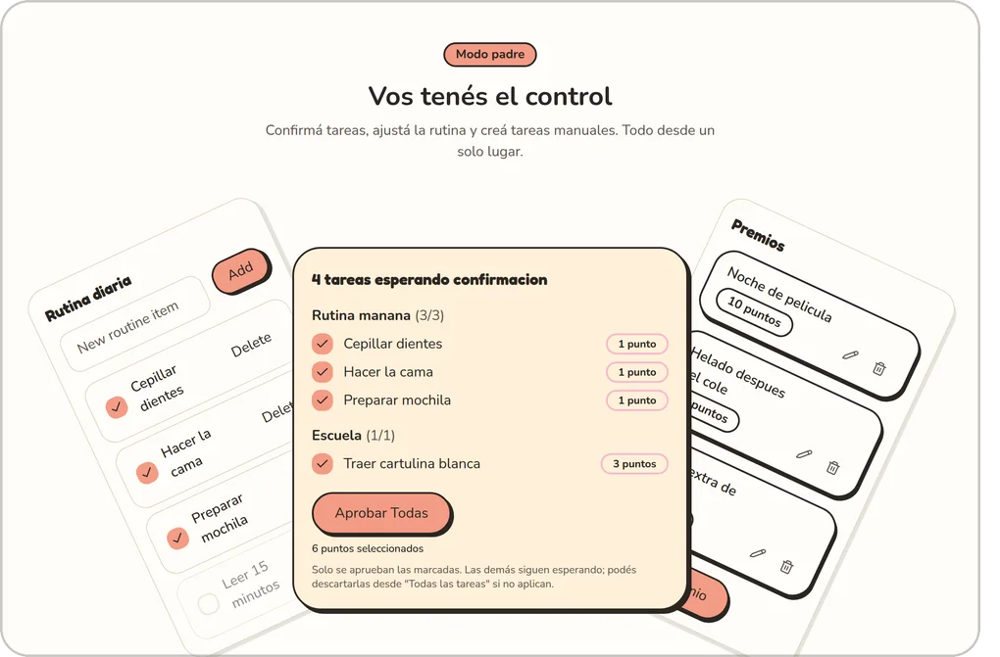
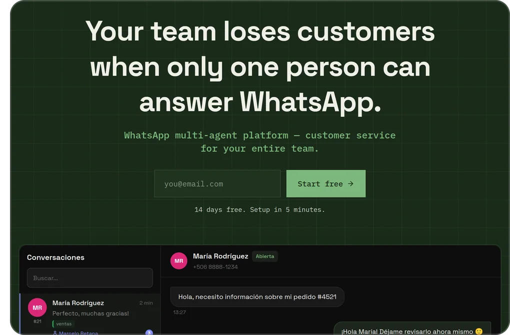
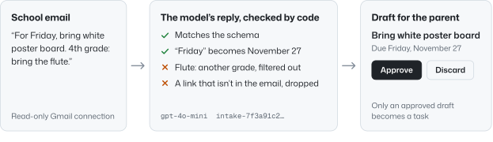
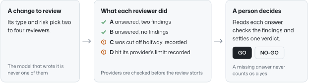

<picture>
  <source media="(prefers-color-scheme: dark)" srcset="assets/title-dark.svg">
  
</picture>

I take work from discovery and spec to release, in TypeScript end to end. In my own products I build LLM features with validated output, traces and a person's approval.

I run [GEXP Software](https://gexpsoftware.com), a small remote studio in Costa Rica (UTC-6). 12 years on the web, remote since 2019. I work in English and Spanish.

## What I've shipped

**[Picomar](https://picomar.com)** is the booking platform of a 46-villa rental company, a client of my studio. Next.js 16, Postgres on Supabase with row-level security, two-way channel-manager sync and card payments. Every change has to pass lint, type checks and a suite of more than 800 test files. [Case study](https://marceloretana.com/work/picomar)

**[Alhena](https://alhena.fun)** is a family task board, my own product. gpt-4o-mini drafts tasks from school email and a parent approves each one. Next.js 16, Drizzle and Neon Postgres. [Case study](https://marceloretana.com/work/alhena)

**[GoEasy.Chat](https://goeasy.chat/en)** is WhatsApp support for teams, my own product. After the Paddle checkout the server creates each customer's workspace and trial, with health checks and self-repair. [Case study](https://marceloretana.com/work/goeasy-chat)

## How I build with AI

**From a school email to a task, in Alhena.** Code checks the model's reply before a parent sees a draft. Every extraction keeps its model name and trace ID, and a failed email is logged and skipped.

<picture>
  <source media="(max-width: 640px) and (prefers-color-scheme: dark)" srcset="assets/email-to-task-dark-mobile.svg">
  <source media="(max-width: 640px)" srcset="assets/email-to-task-light-mobile.svg">
  <source media="(prefers-color-scheme: dark)" srcset="assets/email-to-task-dark.svg">
  
</picture>

**Code review by other models, at GEXP.** On GEXP products agents write much of the code, and the model that wrote a change never reviews it. A harness I built sends each diff or plan to two to four others, and one that fails or gets cut off is recorded with the reason.

<picture>
  <source media="(max-width: 640px) and (prefers-color-scheme: dark)" srcset="assets/review-dark-mobile.svg">
  <source media="(max-width: 640px)" srcset="assets/review-light-mobile.svg">
  <source media="(prefers-color-scheme: dark)" srcset="assets/review-dark.svg">
  
</picture>

I'm also building a terminal agent without a framework: a tool loop, an MCP server, replayable traces, and evals with held-out cases, injection and safety traps, and confidence intervals.

## Where I've worked

- **Universal Music Group**, since 2019: full-stack work on a long-running platform, with React and TypeScript front ends and Node.js services on AWS.
- **TelevisaUnivision**: the monorepo behind 10 high-traffic sites, including Univision.com and TUDN, with Next.js, Relay, GraphQL and React Native.
- **Provectus**: engineer at an AI consultancy and AWS Premier Tier partner, on work for its enterprise clients.
- **IBM**: process tools with React, Node.js and the Carbon Design System.
- **Earlier**: SixFifty, a US legal tech company, and Prodigious, on the Bank of America account.

## Open source and writing

- [chatwoot/chatwoot#13837](https://github.com/chatwoot/chatwoot/issues/13837): how Meta's WhatsApp business-scoped user IDs would break contact matching. Chatwoot's maintainers used it to track the work and closed it as completed in September 2026.
- A bilingual [blog](https://marceloretana.com/blog) and [step-by-step guides](https://marceloretana.com/learn).

## Tools

- **AI:** OpenAI API with structured outputs, Zod, tool calling, MCP, evals
- **Product:** Next.js, React Native, Node.js, GraphQL (Apollo, Relay), Postgres on Supabase, Drizzle, Prisma, Redis
- **Cloud and quality:** AWS (Lambda, S3, CloudFront, DynamoDB, SQS), Vercel, Docker, Turborepo, GitHub Actions, Vitest, Playwright

[Case studies](https://marceloretana.com/work) · [LinkedIn](https://www.linkedin.com/in/marceloretana) · [GEXP Software](https://gexpsoftware.com)
